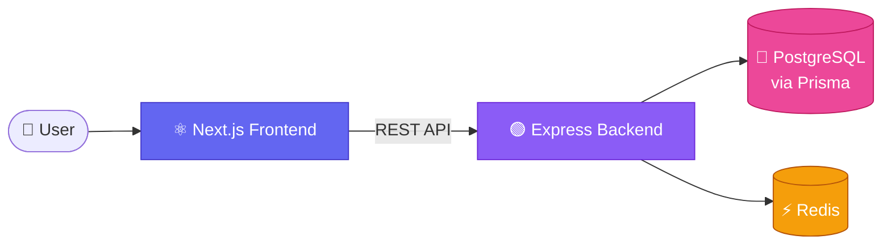

<div align="center">

<sub>━━━━━━━━━━━━━━━━━━━━━━━━━━━━━━━━━━━━━━━━━━━━━━━━━━━</sub>

<br/>

<h1>🧠&nbsp; D E V &nbsp; A S S E S S</h1>

<h3>BUILD SKILLS &nbsp;◆&nbsp; MEASURE TALENT &nbsp;◆&nbsp; HIRE SMARTER</h3>

<sub>━━━━━━━━━━━━━━━━━━━━━━━━━━━━━━━━━━━━━━━━━━━━━━━━━━━</sub>

<br/>

<p>
A modern, full-stack platform for<br/>
<b>developer assessments · coding challenges · technical hiring</b>
</p>

<p>
<code>📝 Create</code> ➜ <code>📨 Invite</code> ➜ <code>⏱️ Assess</code> ➜ <code>📊 Score</code> ➜ <code>🤝 Hire</code>
</p>

<br/>

<table>
  <tr>
    <td align="center" width="200"><h2>3</h2><sub>ROLES<br/>Admin · Recruiter · Candidate</sub></td>
    <td align="center" width="200"><h2>⏱️</h2><sub>TIMED<br/>Assessments</sub></td>
    <td align="center" width="200"><h2>📊</h2><sub>INSTANT<br/>Results & Analytics</sub></td>
  </tr>
</table>

<br/>

<b>[ 🚀 <a href="https://developer-assessment-coding-platfor-pi.vercel.app/">LIVE DEMO</a> ]</b>
&nbsp;&nbsp;·&nbsp;&nbsp;
<b>[ 📂 <a href="https://github.com/mca-programmer/DevAssess">SOURCE CODE</a> ]</b>

<br/><br/>

<sub>Next.js &nbsp;·&nbsp; React &nbsp;·&nbsp; TypeScript &nbsp;·&nbsp; Tailwind CSS &nbsp;·&nbsp; Node.js &nbsp;·&nbsp; Express &nbsp;·&nbsp; Prisma &nbsp;·&nbsp; PostgreSQL &nbsp;·&nbsp; Redis</sub>

</div>

---

## 🧭 Table of Contents

[About](#-about) · [Who Is It For](#-who-is-it-for) · [Features](#-features) · [Architecture](#-architecture) · [Tech Stack](#-tech-stack) · [Getting Started](#-getting-started) · [Author](#-author)

---

## 💡 About

**DevAssess** is a modern, full-stack platform for **developer assessments, coding challenges, and technical hiring**.
Recruiters build and send tests, candidates take them in a focused timed workspace, and everyone gets clear results, all in one place.

> 🎯 One platform. Three roles. Zero hiring chaos.

---

## 👥 Who Is It For

<table>
  <tr>
    <td align="center" width="33%">
      <h3>👨‍💼 Recruiter</h3>
      <sub>Create assessments, manage questions, invite candidates, review results</sub>
    </td>
    <td align="center" width="33%">
      <h3>💻 Candidate</h3>
      <sub>Take timed assessments, submit solutions, track scores</sub>
    </td>
    <td align="center" width="33%">
      <h3>🛡️ Admin</h3>
      <sub>Manage users, monitor platform activity, keep things secure</sub>
    </td>
  </tr>
</table>

---

## ✨ Features

| | Feature | What you get |
|---|---|---|
| 🔐 | **Authentication** | Secure sign-in with role-based access control |
| 📝 | **Assessments** | Create and manage technical tests |
| 👨‍💼 | **Recruiter Dashboard** | Manage questions and invite candidates |
| 💻 | **Candidate Workspace** | Timed assessments with score tracking |
| 📊 | **Results & Analytics** | Review assessment performance at a glance |
| 🛡️ | **Admin Panel** | User management and activity monitoring |
| 🌙 | **Responsive UI** | Modern interface with theme support |

---

## 🏗️ Architecture



---

## 🛠️ Tech Stack

<table>
  <tr>
    <th align="left">🎨 Frontend</th>
    <td>Next.js · React · TypeScript · Tailwind CSS</td>
  </tr>
  <tr>
    <th align="left">⚙️ Backend</th>
    <td>Node.js · Express · Prisma · PostgreSQL · Redis</td>
  </tr>
</table>

---

## ⚡ Getting Started

<details open>
<summary><b>1️⃣ Clone & install</b></summary>

```bash
git clone https://github.com/mca-programmer/DevAssess.git
cd DevAssess
npm install
```

</details>

<details open>
<summary><b>2️⃣ Configure environment</b></summary>

Create a `.env.local` file in the project root:

```env
NEXT_PUBLIC_API_BASE_URL=http://localhost:5000/api/v1
```

</details>

<details open>
<summary><b>3️⃣ Run the dev server</b></summary>

```bash
npm run dev
```

Then open **[http://localhost:3000](http://localhost:3000)** 🎉

</details>

---

## 🔗 Quick Links

| 🌐 Live Application | 💻 GitHub Repository |
|---|---|
| [developer-assessment-coding-platfor-pi.vercel.app](https://developer-assessment-coding-platfor-pi.vercel.app/) | [mca-programmer/DevAssess](https://github.com/mca-programmer/DevAssess) |

---

## 👨‍💻 Author

<div align="center">

**MD MUSARRAF HOSEN**

[@mca-programmer](https://github.com/mca-programmer)

</div>

---

<div align="center">

<sub>━━━━━━━━━━━━━━━━━━━━━━━━━━━━━━━━━━━━━━━━━━━━━━━━━━━</sub>

### ⭐ If you like DevAssess, consider starring the repository!

<sub>━━━━━━━━━━━━━━━━━━━━━━━━━━━━━━━━━━━━━━━━━━━━━━━━━━━</sub>

</div>